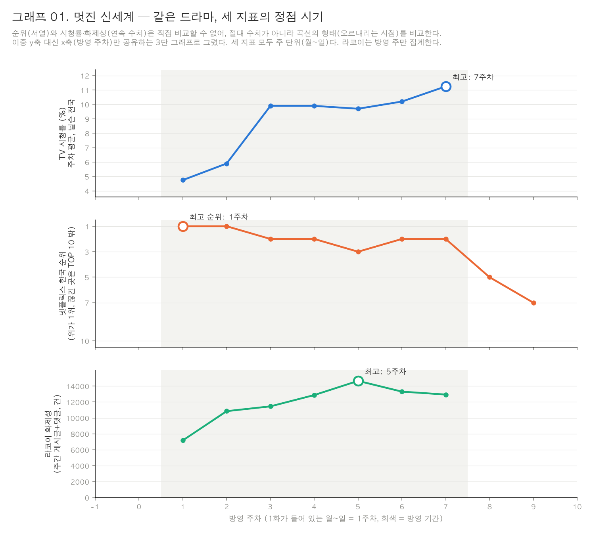

# TV와 넷플릭스, 같은 드라마를 다르게 볼까?

2026년 상반기 TV와 넷플릭스에 동시 방영된 드라마 10편을 **TV 시청률 · 넷플릭스 한국 순위 · 온라인 화제성(라코이)**으로 비교한 시계열 분석입니다. 구글 트렌드 일별 검색 관심도 분석(트렌드·주간 반복·종영 후 감쇠)과 넷플릭스 오리지널 비교는 보조 분석으로 수행했습니다.

> 평가 편의를 위해 수집 완료된 데이터를 `data/raw/`에 동봉했습니다. API 키 설정 없이 아래 순서대로 실행하면 결과를 재현할 수 있습니다.

## 핵심 결과

1. **같은 드라마도 지표마다 정점이 다르다.** 이번 10편 중 8편은 넷플릭스 한국 순위(상대 순위)의 정점이 TV 시청률 정점보다 빨랐다(중앙값 3.5주). 멋진 신세계는 넷플릭스 1주차, 화제성 5주차, 시청률 마지막 7주차가 최고였다.
2. **시청률과 온라인 화제성은 대체로 같은 순서였지만, 반응이 게시글·댓글 중심인 작품과 동영상 조회 중심인 작품이 나뉘었다.** 샤이닝(+4계단)·모두가 자신의 무가치함과 싸우고 있다(+3)는 시청률보다 화제성(라코이 게시글·댓글)이 높았고 영상 조회에 비해 글·댓글이 많았다. 언더커버 미쓰홍은 글·댓글은 5위였지만 동영상 조회는 2위였다.
3. **이번 10편에서는 종영 직전까지 온라인 관심이 유지된 작품이 종영 후 넷플릭스에 더 오래 남는 경향이 있었다.** 넷플릭스를 쓰지 않은 종영 전 지표(라코이 버즈 유지율)와 종영 후 TOP 10 잔존의 순위 일치도는 0.55였다. 작품 규모도 비슷하게 관련 있어(0.70) 10편으로는 둘을 구분할 수 없고, 인과관계를 뜻하지 않는다.

**보너스:** 시계열 분해로 10편 모두 방송 요일(또는 다음 날)에 검색이 몰리는 주간 반복을 확인했고, 넷플릭스 오리지널 8편은 동시 방영작보다 초반 순위는 높지만 7주차부터 TOP 10에서 더 빨리 빠졌다(9주차 잔류 12% vs 50%).

자세한 내용은 [REPORT.md](REPORT.md), 데이터 출처와 수집 방법은 [DATA.md](DATA.md)에 있습니다.



## 실행 방법

Python 3.14에서 확인했습니다.

```bash
git clone https://github.com/riakwjddd06/drama-analysis.git
cd drama-analysis
python3 -m venv .venv
source .venv/bin/activate          # Windows: .venv\Scripts\activate
pip install -r requirements.txt
```

아래 순서대로 실행하면 `data/processed/`와 `images/`의 결과가 다시 만들어집니다.

```bash
python src/load_google.py            # 구글 묶음 연결 → google_kr_daily.csv
python src/load_racoi.py             # 라코이 엑셀 → racoi_weekly.csv
python src/ch1_curves.py             # 1장: TV·넷플릭스 곡선 유형
python src/ch1_competitors.py        # 1장: 넷플릭스 순위 하락 주의 새 경쟁작
python src/graph02_curve_types.py    # 그래프 02
python src/ch2_gap.py                # 2장: 시청률 vs 화제성 갭, 그래프 03·11
python src/ch3_halflife.py           # 3장 보조: 구글 반감기, 그래프 05
python src/ch3_netflix.py            # 3장 메인: 넷플릭스 종영 후 잔존, 그래프 06
python src/ch3_prefinale.py          # 3장: 종영 전 관심 vs 종영 후 잔존, 그래프 10
python src/graph01_triple.py         # 그래프 01
python src/graph07_trend_weekday.py  # 그래프 07
python src/graph12_gap_weekly.py     # 그래프 12 (2장 작품별 주간 흐름)
python src/bonus_decompose.py        # 보너스: 시계열 분해, 그래프 08
python src/bonus_original.py         # 보너스: 오리지널 vs 동시 방영, 그래프 09
```

그래프의 한글 글꼴은 macOS의 AppleGothic입니다. 다른 운영체제에서는 각 스크립트 위쪽의 `plt.rcParams["font.family"]`를 설치된 한글 글꼴(예: Malgun Gothic, NanumGothic)로 바꿔 주세요.

### 데이터를 새로 받으려면

- 넷플릭스: `python src/collect_netflix.py`
- 라코이·구글 트렌드·네이버 데이터랩·펀덱스: 웹에서 내려받았으며, 조회 조건과 링크를 [DATA.md](DATA.md)에 적었습니다.

## 폴더 구조

```
drama-analysis/
├── README.md
├── LICENSE            코드 라이선스 (MIT)
├── REPORT.md            분석 리포트
├── DATA.md              수집 기록·데이터 사전
├── requirements.txt
├── data/
│   ├── dramas.csv       분석 대상 10편
│   ├── originals.csv    넷플릭스 오리지널 8편 (보너스 비교군)
│   ├── raw/             수집한 원본 (시청률, 넷플릭스, 라코이, 구글, 네이버, 펀덱스)
│   └── processed/       코드가 만든 중간 결과
├── src/                 수집·분석·그래프 코드
└── images/              그래프 PNG
```

## 데이터 출처 · 라이선스

- 시청률: 닐슨코리아 발표치(네이버 드라마 정보 재인용)
- 넷플릭스 TOP 10: [Netflix Tudum](https://www.netflix.com/tudum/top10)
- 화제성: [RACOI](https://www.racoi.or.kr) (한국방송광고진흥공사), 굿데이터코퍼레이션 펀덱스 (보도 기사 인용)
- 검색 관심도: Google Trends, 네이버 데이터랩

모든 데이터는 각 서비스의 이용약관을 따르며 학습 목적으로만 사용했습니다.

코드(`src/`)는 [MIT License](LICENSE)를 따릅니다. 데이터에는 적용되지 않습니다.

## AI 사용

분석 기획, 코드 작성, 데이터 검증에 AI(Claude)를 사용했습니다. 작업별 사용 이유와 검증 방법은 [REPORT.md의 AI 사용 로그](REPORT.md#8-ai-사용-로그)에 정리했습니다.
