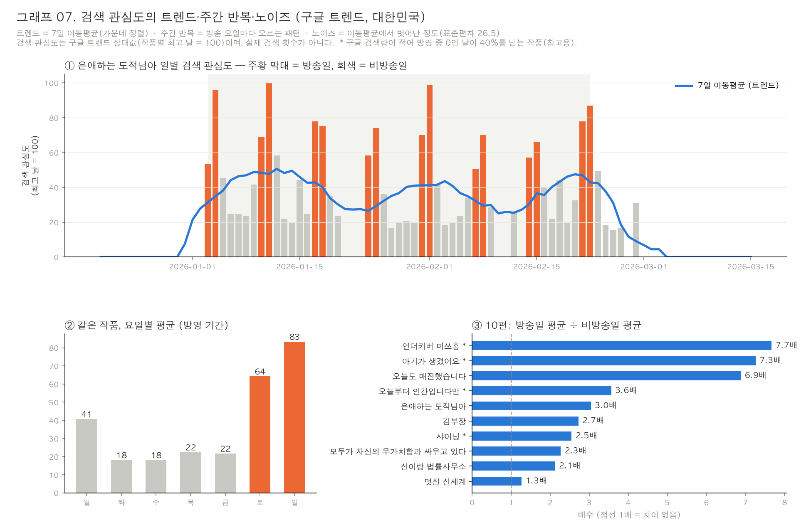
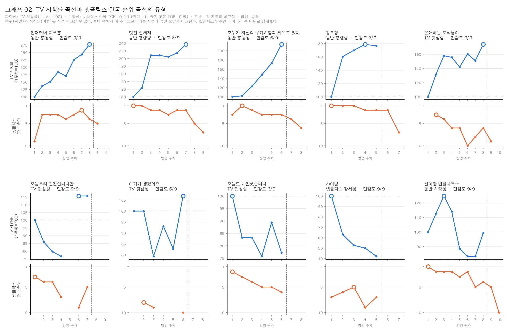
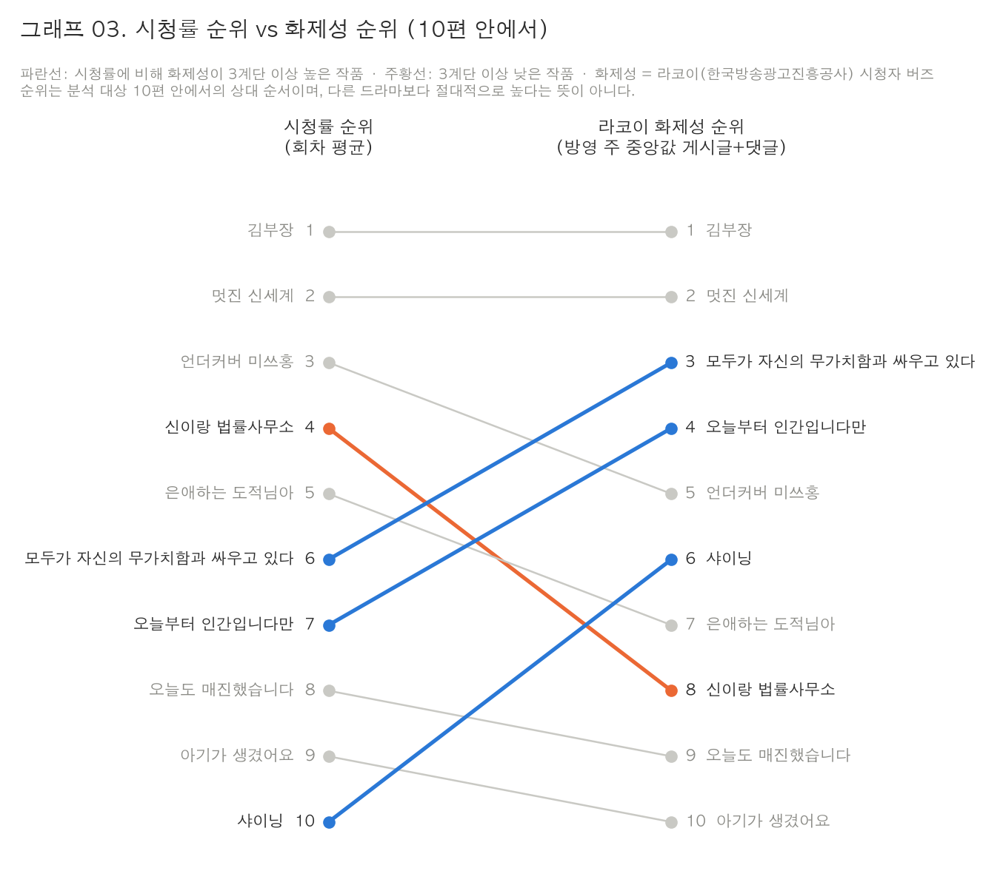
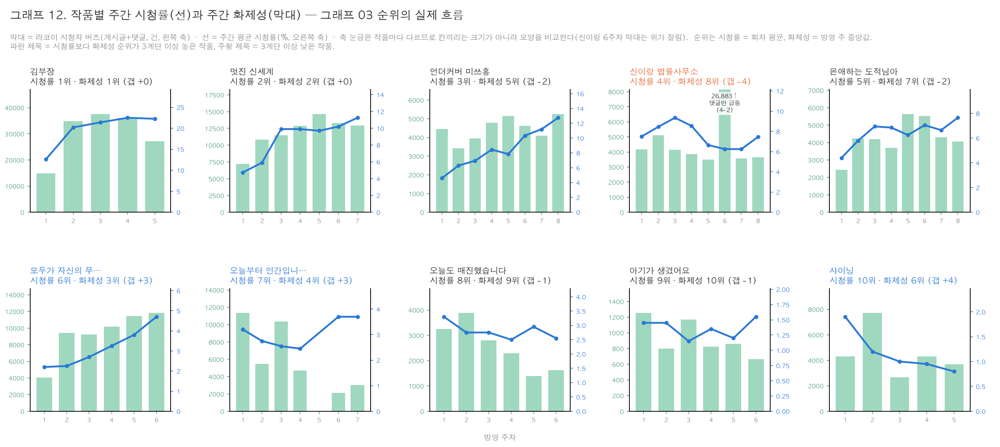
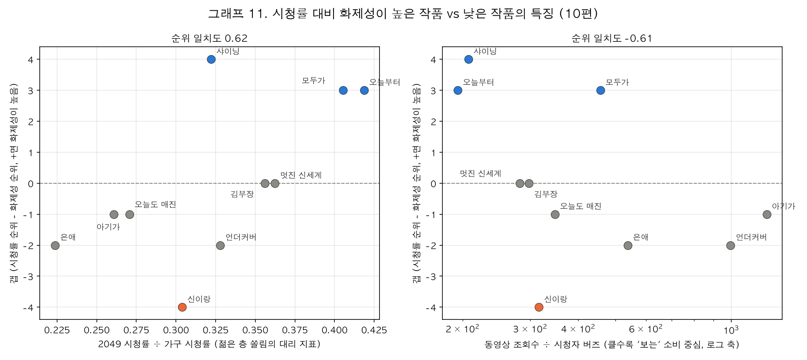
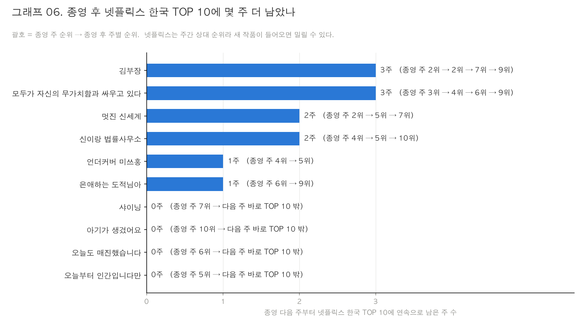
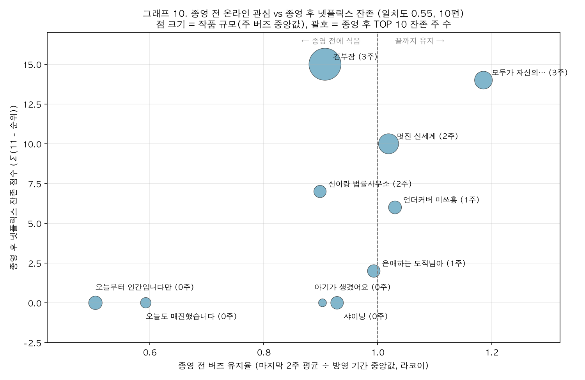
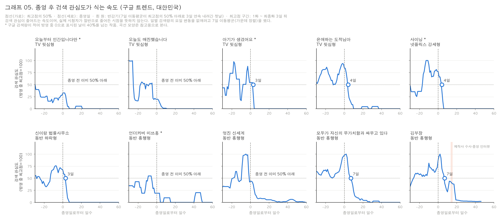
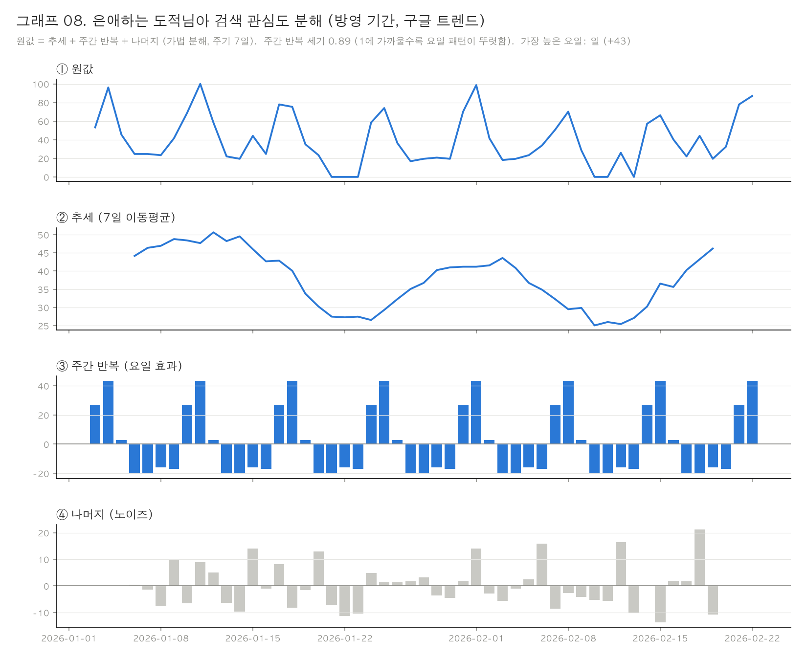
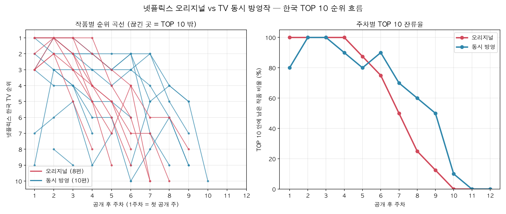

# TV와 넷플릭스, 같은 드라마를 다르게 볼까?

**2026년 상반기 동시 방영 드라마 10편의 시청률·넷플릭스 순위·화제성 분석**

작성일: 2026-11-02

---

## 1. 분석 주제 및 선정 이유

드라마를 TV 본방으로만 보던 시대에서 넷플릭스 같은 OTT로 함께 보는 시대로 바뀌면서, "시청률은 낮아도 화제작"이라는 말이 자주 나온다. 시청률 하나만으로는 드라마의 인기를 설명하기 어렵다는 문제의식을 데이터로 확인해 보고 싶었다.

그래서 같은 드라마를 **TV 시청률, 넷플릭스 한국 순위, 온라인 화제성**이라는 세 개의 창으로 보고, 인기가 언제 오르고 언제 식는지 비교했다. 상반기 작품은 종영 후 3개월 이상 지났기 때문에, 방영 전부터 종영 후까지 "인기의 일생" 전체를 관찰할 수 있다.

## 2. 분석 질문

| # | 질문 | 답하는 장 |
|---|---|---|
| Q1 | 같은 드라마라도 TV 시청률 곡선과 넷플릭스 순위 곡선은 모양이 다를까? | 1장 |
| Q2 | (A) 시청률과 온라인 화제성은 같은 순서일까? (B) 시청률에 비해 화제성이 유난히 높거나 낮은 작품은 어떤 특징이 있을까? | 2장 |
| Q3 | 종영 후 인기는 얼마나 오래 가고, 종영 직전까지 관심이 유지된 작품일수록 더 오래 갈까? | 3장 |

처음 기획에서 Q2는 "검색 관심도(네이버·구글)"를, Q3는 "검색 관심도 반감기"를 기준으로 했다. 수집해 보니 검색 지표의 측정 문제가 커서(4-3) 화제성 메인 지표를 **라코이(한국방송광고진흥공사)**로, 종영 후 지표를 **넷플릭스 한국 TOP 10 잔존**으로 바꾸고 질문도 그에 맞게 고쳤다. Q3는 처음에 1장 곡선 유형별로 비교했지만, 유형 판정에 넷플릭스 후반 순위가 들어가 "넷플릭스로 나눈 그룹을 넷플릭스로 비교하는" 순환 문제가 있었다. 그래서 넷플릭스를 쓰지 않은 종영 전 지표(라코이 버즈, 시청률)와 비교하도록 바꿨다(5-4).

## 3. 데이터 설명

본 분석은 TV 시청률, 넷플릭스 한국 순위, 라코이 화제성, 구글 검색 관심도, 네이버 검색량, 펀덱스 화제성 6개 출처를 **"작품명 + 날짜(주차)"를 키로 하는 긴 형식(long format) 데이터**로 정리했다. 출처마다 단위가 달라(회차별·주별·일별) 날짜 하나로 옆으로 붙이지 않고, 회차별 시청률·주별 넷플릭스 순위·주별 라코이 화제성은 **방영 주차** 단위로 맞춰 함께 분석했다. 일별 흐름(트렌드·주간 반복·노이즈, 종영 후 감쇠)은 **구글 트렌드 일별 데이터(10편 × 269일 = 2,690행)**로 분석했다.

### 3-1. 분석 대상 (10편)

선정 기준: ① 1화 방영일 2026-01-01 ~ 06-30, ② TV 방영과 넷플릭스 국내 동시 공개, ③ 8~16부작, ④ 2026-08-31 이전 종영. 넷플릭스 TOP 10 진입 여부는 기준에 넣지 않았다(선택 편향 방지). 넷플릭스 오리지널은 제외했다. 결과적으로 10편 모두 한국 TOP 10에 1주 이상 들었는데, 기준을 만족한 후보 전체와 제외 이유(넷플릭스 국내 미공개 12편 등), 넷플릭스 TOP 10 자료로 빠진 후보가 없는지 교차 확인한 결과는 `DATA.md` 1-5에 정리했다.

| 작품 | 방송사 | 방영 기간 | 부작 |
|---|---|---|---|
| 은애하는 도적님아 | KBS2 | 01-03 ~ 02-22 | 16 |
| 오늘부터 인간입니다만 | SBS | 01-16 ~ 02-28 | 12 |
| 언더커버 미쓰홍 | tvN | 01-17 ~ 03-08 | 16 |
| 아기가 생겼어요 | 채널A | 01-17 ~ 02-22 | 12 |
| 샤이닝 | JTBC | 03-06 ~ 04-03 | 10 |
| 신이랑 법률사무소 | SBS | 03-13 ~ 05-02 | 16 |
| 모두가 자신의 무가치함과 싸우고 있다 | JTBC | 04-18 ~ 05-24 | 12 |
| 오늘도 매진했습니다 | SBS | 04-22 ~ 05-28 | 12 |
| 멋진 신세계 | SBS | 05-08 ~ 06-20 | 14 |
| 김부장 | SBS | 06-26 ~ 07-25 | 10 |

### 3-2. 출처와 역할

| 데이터 | 출처 | 단위 · 기간 | 규모 | 역할 |
|---|---|---|---|---|
| TV 시청률 | 네이버 드라마 정보 '시청률' 탭 (제공: 닐슨코리아, 전국) | 회차별, 2026-01-03 ~ 07-25 | 130회차 | 1·2장 |
| 넷플릭스 한국 순위 | Netflix Tudum TOP 10 | 주별(월~일), TOP 10만 | 74행 | 1장, **3장 메인** |
| 라코이 화제성 | [RACOI](https://www.racoi.or.kr) 인터넷반응DB (한국방송광고진흥공사) | 주별, 방영 주만 | 65행 | **2장 메인**, 그래프 01 |
| 구글 검색 관심도 | Google Trends, 주제(Topic), 대한민국 | 일별, 2025-12-15 ~ 2026-09-09 | 2,690행 | 일별 흐름 분석, 3장 보조 |
| 펀덱스 화제성 | 굿데이터코퍼레이션 펀덱스 (보도 기사) | 주별, 2~30주차 중 21주 | 42행 | 2장 검증 |
| 네이버 검색량 | 네이버 데이터랩 검색어 트렌드 | 일별, 2025-12-01 ~ 2026-10-15 | 3,190행 | 검증 |

**라코이**는 방송통신위원회 사업으로 한국방송광고진흥공사가 운영하는 방송콘텐츠 인터넷 반응 조사다. 지상파·종편·케이블 프로그램별로 네이버 뉴스·블로그·카페, 다음카페, 유튜브, 커뮤니티의 반응을 주마다 **실제 건수**로 집계한다. 이 분석에서는 **시청자 버즈 = 게시글 수 + 댓글 수**를 화제성 메인 지표로 썼다.

### 3-3. 주요 컬럼

| 파일 | 컬럼 | 설명 |
|---|---|---|
| `data/raw/ratings.csv` | title, episode, air_date, rating | 회차별 시청률(%) |
| `data/processed/nf_kr_weekly.csv` | title, week_no, week, weekly_rank | 넷플릭스 한국 주간 순위, TOP 10 밖은 행 없음 |
| `data/processed/racoi_weekly.csv` | title, week, week_no, posts, comments, buzz, views, news, videos, rating_hh, rating_2049 | 라코이 주간 반응 건수와 닐슨 시청률(가구·2049) |
| `data/processed/google_kr_daily.csv` | title, date, value_level, value_shape | 구글 검색 관심도 (작품 간 비교용 / 작품별 최고 날 = 100) |
| `data/raw/fundex.csv` | iso_week, week_start, rank, title, share | 펀덱스 주간 순위와 점유율(%) |

## 4. 데이터 정제

### 4-1. 출처별 기본 정보 확인

| 출처 | 확인 결과 |
|---|---|
| 시청률 | 결측 0건. 닐슨코리아 공식 TOP 자료와 대조한 104회차 모두 일치. 나머지 26회차는 공식 자료에 없어 회차 단위로는 대조하지 못했고, 전 회차가 들어가는 라코이의 닐슨 주간 시청률(65주) 대조로 간접 확인했다(차이 평균 0.14%p. 라코이는 주 단위로 집계한 값이고 이 분석은 회차 시청률을 주별로 단순 평균했기 때문에 생기는 차이로 보인다) |
| 라코이 | 10편 모두 1주차부터 마지막 방영 주까지 빠짐없이 있음. 오늘부터 인간입니다만의 빈 주 1개는 설 연휴 결방 주 |
| 넷플릭스 | 10편 모두 1주 이상 TOP 10 진입. 금·토 첫 방송 작품은 1주차 공개일이 1~2일뿐이라 1주차 순위가 불리 |
| 구글 | 10편 모두 일별 값 존재. 언더커버 미쓰홍의 중복 주제는 전 기간 0(검색이 나뉘어 잡히지 않음). 방영 중 0인 날이 40%를 넘는 검색량 적은 작품 4편(이하 \* 표시) |
| 펀덱스 | 32주 중 21주 확보. 1·4·10·12·15·16·17·21·24·31·32주차는 순위 기사를 찾지 못함 |
| 네이버 | 결측 0건. 일상어 제목 4편은 방영 전·종영 후에도 값이 남음(4-3) |

### 4-2. 결측·이상치 기준

| 상황 | 기준 | 처리 |
|---|---|---|
| 결방 주 | 회차 없음 = 실제로 방송이 없었던 것 | 빈칸 유지, 그래프에서 선을 끊음 |
| 넷플릭스 TOP 10 밖 | 순위가 공개되지 않음 | 빈칸 유지 (11위로 채우지 않음) |
| 라코이 첫 주·마지막 주 | 주 중간에 시작·종영해 반응이 덜 쌓임 | 그대로 두되, 작품 간 비교는 방영 주 **중앙값**으로 해 주 수 차이를 줄임 |
| 라코이 한 주 급등 | 한 주가 다른 주의 수 배 | 기사로 원인 확인(아래 표). 작품 간 비교는 주 **중앙값**으로 해 한 주가 전체를 좌우하지 않게 하고, 평균으로 계산한 결과는 민감도로 함께 제시 |
| 구글 `<1` 표기 | 0보다 크지만 1 미만 | 0.5로 바꿈 |
| 구글 방영 중 0인 날 40% 초과 | 검색이 기준보다 적은 날은 0으로 표시됨 | **\*** 표시, 구글 기반 값은 참고용 (오늘부터 인간입니다만, 언더커버 미쓰홍, 아기가 생겼어요, 샤이닝) |
| 방송과 무관해 보이는 하루짜리 급등 (구글) | 네이버 뉴스 기간 검색 + 같은 날 네이버 검색량 변화로 확인 | 아래 표 |

| 급등 | 확인한 내용 | 판단 |
|---|---|---|
| 멋진 신세계 6/14 | 6/13 12회 반전 엔딩, 6/14 자체 최고 시청률 보도·예능 출연 예고 | 드라마 관련 → **유지** |
| 김부장 8/8~9 | 8/8 제작사 회장 수사 보도, 8/8~9 출연진 종영 인터뷰 집중 | 드라마 관련 → **유지**, "종영 후 재상승 이벤트"로 표시 |
| 멋진 신세계 8/2~3 | 8/1~3 관련 기사 없음, 같은 날 네이버 검색량 변화 없음 | 무관한 검색 → **제외**, 앞뒤 값으로 보간 |
| 신이랑 법률사무소 라코이 6주차 (4/13~19) | **댓글만** 25,928건으로 다른 주(2,200~3,500)의 약 10배. 같은 주 게시글·동영상 조회·동영상 수는 8주 중 가장 적었고 뉴스는 평소 수준. 네이버 뉴스 기간 검색: 경쟁작 21세기 대군부인(4/10 첫 방송)에 동시간대 1위를 내주고 시청률이 9.5%→6%대로 떨어졌다는 비교 기사가 몰렸고, 4/18 12회 의식불명·"영혼 분리" 엔딩 | 드라마 관련이지만 일부 글에 댓글이 몰린 좁은 반응 → **유지**, 작품 비교는 중앙값 사용 |

### 4-3. 검색 지표를 메인으로 쓰지 않은 이유

처음에는 검색량을 화제성 지표로 쓰려 했다. 수집해 보니 두 검색 지표 모두 작품끼리 공정하게 비교하기 어려웠다.

- **네이버 데이터랩 (검색어 방식):** 10편 모두 같은 규칙으로 검색어를 만들었지만, 시청률 0.8~2%인 샤이닝이 13%까지 오른 언더커버 미쓰홍보다 검색량이 50배 넘게 나왔다. 제목이 독특한 작품은 제목만 검색해 규칙에 잘 안 잡히고, 흔한 단어 제목은 "샤이닝 드라마"처럼 덧붙여 검색해 잘 잡히기 때문이다.
- **구글 트렌드 (주제 방식):** 검색어 문제는 없지만, 검색이 적은 날을 0으로 표시해 10편 중 4편이 방영 중 절반 가까운 날이 0이었다(검색량 적음). 한국 검색 점유율이 낮고 분류 방식도 공개되지 않는다.

그래서 화제성 메인 지표를 **라코이 시청자 버즈**로 바꾸었다. 프로그램 단위로 실제 반응 건수를 세기 때문에 검색어 문제와 0값 문제가 없고, 공공기관이 같은 방식으로 모든 채널을 집계한다. 다만 **방영 주에만** 집계되므로, 종영 후 분석(3장)은 넷플릭스 한국 TOP 10 잔존을 메인으로, 구글 반감기를 보조로 썼다. 구글 일별 데이터는 일별 흐름(5-1)에도 썼다.

### 4-4. 시간축 정렬과 묶음 연결

- **방영 주차:** 1화가 들어 있는 월~일 주를 1주차로 정했다. 넷플릭스와 라코이 모두 월~일 주간이라 같은 틀에 맞췄다. 라코이 주차 코드(예: 202615)는 ISO 연도·주차라 그 주 월요일로 바꿨다.
- **구글 묶음 연결:** 구글 트렌드는 한 번에 5개까지만 비교되고 묶음마다 최고점을 100으로 바꾼다. 4개 묶음에 겹치는 작품을 넣고, 그 작품의 합계 비율로 모든 묶음을 같은 눈금에 맞췄다. 연결 검증 결과 같은 작품의 환산값 차이 1.4%, 두 경로로 계산한 배율 차이 0.5%였다.

### 4-5. 데이터 검증

| 검증 | 방법 | 결과 |
|---|---|---|
| 시청률 이중 대조 | 닐슨 공식 자료(130회차 중 104회차), 라코이 닐슨 주간 시청률(65주, 전 회차) | 불일치 0건 / 차이 평균 0.14%p |
| 화제성 지표끼리 | 라코이 시청자 버즈 vs 펀덱스 순위 (스피어만) | 0.73 |
| 펀덱스 원문 대조 | 3·8·14·19·27주차 기사 원문(일부는 펀덱스 사이트 화면)과 대조 | 13행 순위·점유율 모두 일치. 기사의 '지난주' 수치로 13·18주차 3행도 일치 확인 |
| 방송일 반응 (구글) | 방영 기간 방송일 평균 ÷ 비방송일 평균 | 10편 모두 1보다 큼(1.3~7.7배) |
| 네이버와 곡선 비교 (구글) | 일별 7일 이동평균 상관 | 10편 중 8편 0.7 이상 |
| 넷플릭스 순위 하락과 경쟁작 | 순위가 2계단 이상 떨어진(또는 TOP 10에서 빠진) 주에 지난 8주간 TOP 10에 없던 작품이 위로 들어왔는지 | 하락 24번 중 100%, 하락 없는 47번 중 53% |
| 종영 후 지표끼리 | 넷플릭스 잔존 vs 구글 반감기 (스피어만) | 0.68 (종영 전 반감 작품 제외 6편) |
| 기준 바꾸기 | 유형 판정·반감기를 각각 9가지 기준으로 재계산 | 5-2, 5-4 참고 |

## 5. 분석 결과 및 시각화

적용한 시계열 기법: **7일 이동평균**(가운데 정렬), **정규화**(1주차 = 100, 작품별 최고점 = 100), **구간별 통계**(초반·후반 1/3 평균), **요일별 집계**, **반감기**, **민감도 분석**, 보너스로 **시계열 분해**(주기 7일 가법 분해).

### 5-1. 시계열의 트렌드·계절성·노이즈



- **계절성(주간 반복):** 은애하는 도적님아는 방송일인 토·일 평균 검색 관심도가 64·83이고, 화~금은 18~22다. 10편 **모두** 방송일 검색이 비방송일보다 많았다(1.3~7.7배). 여러 작품에서 같은 패턴이 보이므로 방송 요일에 따른 주간 주기가 있다고 판단했다.
- **방송 다음 날 여운:** 일요일 방송 다음 날인 월요일 평균은 41로, 다른 평일의 약 2배였다.
- **트렌드:** 7일 이동평균은 방영 내내 40~50 수준의 봉우리를 세 번 반복할 뿐 계속 오르지 않았다. 같은 기간 TV 시청률은 4.4%에서 7.65%로 올랐다.
- **노이즈:** 이동평균에서 벗어난 정도(표준편차)가 26.5로 방영 기간 평균(39.8)의 3분의 2에 이른다. 대부분은 주간 반복으로 설명되므로, 일별 분석에는 7일 이동평균을 썼다.

### 5-2. 1장. TV 곡선 vs 넷플릭스 곡선 (Q1)




**유형 판정 기준**
- TV: 마지막 1/3 회차 평균 ÷ 처음 1/3 회차 평균이 1.1배 이상이면 상승, 0.9배 이하면 하락, 그 사이는 유지. 시청률은 비율 데이터라 배수로 비교했다.
- 넷플릭스: 순위는 서열 데이터라 배수 대신 **계단 수**로 봤다. 후반부에 TOP 10을 벗어났거나 후반 평균 순위가 2계단 이상 내려가면 하락, 2계단 이상 오르면 상승.

| 유형 | 작품 |
|---|---|
| 동반 흥행형 (TV↑ 넷플릭스↑) | 언더커버 미쓰홍, 모두가 자신의 무가치함과 싸우고 있다, 멋진 신세계, 김부장 |
| TV 뒷심형 (TV↑ 넷플릭스↓) | 은애하는 도적님아, 오늘부터 인간입니다만, 아기가 생겼어요, 오늘도 매진했습니다 |
| 넷플릭스 강세형 (TV↓ 넷플릭스↑) | 샤이닝 |
| 동반 하락형 (TV↓ 넷플릭스↓) | 신이랑 법률사무소 |

**정점 시기 비교**

| 작품 | TV 최고 주차 | 넷플릭스 최고 순위 주차 | 차이 |
|---|---|---|---|
| 은애하는 도적님아 | 8 | 2 | 6주 |
| 멋진 신세계 | 7 | 1 | 6주 |
| 오늘부터 인간입니다만 | 6 | 1 | 5주 |
| 모두가 자신의 무가치함과 싸우고 있다 | 6 | 2 | 4주 |
| 아기가 생겼어요 | 6 | 2 | 4주 |
| 김부장 | 4 | 1 | 3주 |
| 신이랑 법률사무소 | 3 | 1 | 2주 |
| 언더커버 미쓰홍 | 8 | 7 | 1주 |
| 오늘도 매진했습니다 | 1 | 1 | 같음 |
| 샤이닝 | 1 | 3 | 넷플릭스가 2주 늦음 |

**민감도:** TV 기준(1.05·1.1·1.15배) × 넷플릭스 기준(1·2·3계단) 9가지 조합으로 다시 판정했다. 은애하는 도적님아, 오늘부터 인간입니다만, 언더커버 미쓰홍, 샤이닝, 신이랑 법률사무소는 9/9 유형이 유지됐다. 나머지 5편은 6/9로, 넷플릭스 순위 변화가 1계단이거나(모두가…, 멋진 신세계, 김부장) TV 비율이 경계 근처(아기가 생겼어요 0.95, 오늘도 매진했습니다 0.91)였다.

### 5-3. 2장. 시청률 vs 화제성 (Q2)

#### Q2-A. 시청률과 온라인 화제성은 같은 순서일까?



**순위 산정:** 분석 대상 10편 안에서 회차 평균 시청률 순위와 방영 주 **중앙값** 라코이 시청자 버즈(게시글 + 댓글) 순위를 매겼다. 갭 = 시청률 순위 − 화제성 순위(+면 시청률에 비해 화제성이 높음). 평균 대신 중앙값을 쓴 이유는 한 주 급등(신이랑 법률사무소 6주차, 4-2)이 작품 전체 값을 좌우하지 않게 하기 위해서다. 이 값은 10편 안에서의 상대적 차이일 뿐, 다른 드라마보다 화제성이 절대적으로 높다는 뜻은 아니다.

| 작품 | 시청률 | 라코이 버즈 (주 중앙값, 건) | 버즈 | 동영상 조회 | 뉴스 | 구글 | 갭 | 갭 (버즈 평균 기준) |
|---|---|---|---|---|---|---|---|---|
| 김부장 | 1 | 34,829 | 1 | 1 | 1 | 1 | 0 | 0 |
| 멋진 신세계 | 2 | 12,875 | 2 | 4 | 2 | 2 | 0 | 0 |
| 언더커버 미쓰홍 | 3 | 4,542 | 5 | **2** | 4 | 9 | −2 | −4 |
| 신이랑 법률사무소 | 4 | 4,011 | 8 | 6 | 5 | 6 | **−4** | 0 |
| 은애하는 도적님아 | 5 | 4,216 | 7 | 5 | 8 | 5 | −2 | −3 |
| 모두가 자신의 무가치함과 싸우고 있다 | 6 | 9,806 | 3 | 3 | 3 | 4 | **+3** | +3 |
| 오늘부터 인간입니다만 | 7 | 5,089 | 4 | 8 | 6 | 7 | **+3** | +2 |
| 오늘도 매진했습니다 | 8 | 2,543 | 9 | 10 | 7 | 3 | −1 | −1 |
| 아기가 생겼어요 | 9 | 842 | 10 | 7 | 10 | 10 | −1 | −1 |
| 샤이닝 | 10 | 4,299 | 6 | 9 | 9 | 8 | **+4** | +4 |

**출처 간 순위 일치도 (스피어만 상관, 10편)**

| 지표 | 시청률과의 일치도 |
|---|---|
| 라코이 뉴스 수 | 0.85 |
| 라코이 동영상 조회수 | 0.83 |
| **라코이 시청자 버즈 (메인)** | **0.64** |
| 구글 검색 | 0.55 |
| 네이버 검색 | 0.20 |
| (검증용) 펀덱스 | 0.94 |

펀덱스는 확보된 주 중 **최고 순위**로 매겨, 한 주만 높았던 작품도 높게 잡힌다. 그래서 결론의 근거로 쓰지 않고 라코이와의 일치도(0.73)를 확인하는 검증용으로만 썼다.

- 상위 2편(김부장, 멋진 신세계)은 모든 지표에서 순서가 같았다. 10편 전체로는 시청률과 **뉴스·동영상 조회수**(0.83~0.85)가 **시청자 버즈**(0.64)보다 더 비슷한 순서였다. "얼마나 보고 보도됐나"는 시청률과 닮았고, "시청자가 얼마나 이야기했나"는 작품마다 차이가 컸다.
- 시청률보다 화제성이 높은 쪽(**샤이닝 +4, 모두가 자신의 무가치함과 싸우고 있다 +3**)은 중앙값·평균 어느 기준에서도 같았다. 오늘부터 인간입니다만은 +3(중앙값)·+2(평균)였다.
- 반대쪽은 기준에 따라 달랐다. 신이랑 법률사무소는 중앙값 기준 −4지만 평균 기준 0(6주차 댓글 급등 때문), 언더커버 미쓰홍은 −2·−4, 은애하는 도적님아는 −2·−3이었다. "화제성이 낮다"는 결론은 "높다"보다 약하다.



그래프 12는 그래프 03의 순위 뒤에 있는 실제 흐름을 작품마다 보여 준다(막대 = 주간 화제성, 선 = 주간 시청률). 시청률보다 화제성이 높은 모두가 자신의 무가치함과 싸우고 있다·샤이닝은 화제성 막대가 시청률보다 일찍 크게 올랐고, 신이랑 법률사무소는 6주차 한 주(댓글만 급등)를 빼면 화제성이 방영 내내 낮은 수준이었다.

#### Q2-B. 갭이 큰 작품은 어떤 특징이 있을까?



| 작품 | 방송사 | 갭 | 2049 비율 | 조회 ÷ 버즈 | 뉴스 ÷ 버즈 |
|---|---|---|---|---|---|
| 샤이닝 | JTBC | +4 | 0.32 | 207 | 0.036 |
| 오늘부터 인간입니다만 | SBS | +3 | 0.42 | 194 | 0.040 |
| 모두가 자신의 무가치함과 싸우고 있다 | JTBC | +3 | 0.41 | 457 | 0.031 |
| 멋진 신세계 | SBS | 0 | 0.36 | 282 | 0.038 |
| 김부장 | SBS | 0 | 0.36 | 298 | 0.027 |
| 아기가 생겼어요 | 채널A | −1 | 0.26 | 1,237 | 0.132 |
| 오늘도 매진했습니다 | SBS | −1 | 0.27 | 348 | 0.078 |
| 은애하는 도적님아 | KBS2 | −2 | 0.22 | 538 | 0.041 |
| 언더커버 미쓰홍 | tvN | −2 | 0.33 | 997 | 0.054 |
| 신이랑 법률사무소 | SBS | −4 | 0.30 | 316 | 0.056 |

- **2049 비율** = 2049 시청률 ÷ 가구 시청률(라코이 제공 닐슨 값). **조회 ÷ 버즈** = 동영상 조회수 ÷ 게시글·댓글 수로, 클수록 글·댓글보다 동영상 조회 중심이다. 조회수는 본 사람 수가 아니라 조회 횟수이고, 글·댓글도 같은 사람이 여러 번 남길 수 있다. 따라서 아래의 "반응 유형"은 시청자 유형을 직접 확인한 것이 아니라 집계된 반응의 구성이다.
- 갭과의 순위 일치도: 2049 비율 0.62, 조회 ÷ 버즈 −0.61, 뉴스 ÷ 버즈 −0.67, 댓글 ÷ 게시글 0.39.
- 화제성이 높은 3편 중 2편(오늘부터 인간입니다만 0.42, 모두가 자신의 무가치함과 싸우고 있다 0.41)은 2049 비율이 10편 중 가장 높았다. 3편 모두 조회 ÷ 버즈가 194~457로 낮아, 동영상 조회에 비해 글·댓글이 많았다(**게시글·댓글 중심 반응**).
- 화제성이 낮은 쪽 중 언더커버 미쓰홍(997)·아기가 생겼어요(1,237)·은애하는 도적님아(538)는 조회 ÷ 버즈가 높았다. 조회는 많지만 글·댓글은 적은 **동영상 조회 중심 반응**이다. 신이랑 법률사무소(316)는 이 패턴에서 벗어나며, 화제성이 낮게 잡힌 기간이 경쟁작 등장 후 시청률 하락기와 겹친다(4-2).
- **주의:** 2049 비율은 실제 시청자 연령 구성비가 아니다. 라코이는 2049 시청자 수는 주지만 전체 개인 시청자 수는 주지 않아 구성비를 계산할 수 없다. 지상파(가구)와 종편·케이블(유료플랫폼 가입 가구)의 시청률 기준 차이도 있어, JTBC 2편이 모두 +인 것은 채널 효과일 수도 있다.

### 5-4. 3장. 종영 후 인기는 얼마나 오래 가나 (Q3)



그래프 06은 작품마다 종영 후 넷플릭스 한국 TOP 10에 몇 주 더 남았는지와, 종영 주부터 빠질 때까지의 순위 변화를 보여 준다.

**메인 — 넷플릭스 한국 TOP 10 잔존:** 최종화가 들어 있는 주의 다음 주부터 연속으로 TOP 10에 남은 주 수. 주 수가 같으면 잔존 점수(남은 주마다 11 − 순위를 더한 값)로 순서를 가렸다.

**보조 — 구글 검색 관심도 반감기:** 최종화 다음 날부터, 7일 이동평균(가운데 정렬)이 최고점(1화 ~ 최종화 3일 뒤)의 50% 아래로 내려간 뒤 3일 이상 연속 유지되는 첫날까지의 일수. 종영일에 이미 최고점의 50% 아래였던 작품은 "종영 전 반감"으로 따로 표시했다.

| 작품 | 유형 | 종영 주 넷플릭스 순위 | 종영 후 잔존 | 잔존 점수 | 구글 반감기 |
|---|---|---|---|---|---|
| 김부장 | 동반 흥행형 | 2 | **3주** | 15 | 7일 |
| 모두가 자신의 무가치함과 싸우고 있다 | 동반 흥행형 | 3 | **3주** | 14 | 7일 |
| 멋진 신세계 | 동반 흥행형 | 2 | 2주 | 10 | 종영 전 반감 |
| 신이랑 법률사무소 | 동반 하락형 | 4 | 2주 | 7 | 3일 |
| 언더커버 미쓰홍 | 동반 흥행형 | 4 | 1주 | 6 | 종영 전 반감 \* |
| 은애하는 도적님아 | TV 뒷심형 | 6 | 1주 | 2 | 4일 |
| 샤이닝 | 넷플릭스 강세형 | 7 | 0주 | 0 | 4일 \* |
| 아기가 생겼어요 | TV 뒷심형 | 10 | 0주 | 0 | 3일 \* |
| 오늘도 매진했습니다 | TV 뒷심형 | 6 | 0주 | 0 | 종영 전 반감 |
| 오늘부터 인간입니다만 | TV 뒷심형 | 5 | 0주 | 0 | 종영 전 반감 \* |

\* 구글 검색량이 적어 방영 중 0인 날이 40%를 넘는 작품(4-2). 구글 반감기는 참고용이다.

넷플릭스 잔존과 구글 반감기의 순서 일치도는 0.68(종영 전 반감 작품 제외 6편)이었다. 서로 다른 두 출처가 "어느 작품이 종영 후 오래 갔는지"에 대해 비슷한 순서를 보였다.

참고로 1장 유형별 평균 잔존은 동반 흥행형 2.25주, 동반 하락형 2주, TV 뒷심형 0.25주, 넷플릭스 강세형 0주였다. 다만 유형 판정에 넷플릭스 후반 순위가 들어가 있어 이 비교는 독립적인 근거가 아니므로, 아래처럼 종영 전 지표로 다시 확인했다.

#### 종영 전 관심과 종영 후 잔존 (넷플릭스를 쓰지 않은 비교)



종영 후 결과(넷플릭스 잔존 점수)를 **넷플릭스를 전혀 쓰지 않은 종영 전 지표**와 비교했다.

- **버즈 유지율** = 마지막 2주 라코이 버즈 평균 ÷ 방영 기간 주 버즈 중앙값. 1보다 크면 끝까지 관심이 유지·상승, 작으면 종영 전에 식은 것이다. 분모를 최고 주가 아닌 중앙값으로 둔 이유는 한 주 급등(신이랑 법률사무소 6주차, 다른 주의 약 7배)에 결과가 좌우되지 않게 하기 위해서다.
- **시청률 유지율** = 최종화 시청률 ÷ 최고 회차 시청률
- **버즈 규모** = 주 버즈 중앙값 (작품 크기)

| 작품 | 버즈 유지율 | 시청률 유지율 | 버즈 규모 (건/주) | 종영 후 잔존 |
|---|---|---|---|---|
| 김부장 | 0.91 | 1.00 | 34,829 | 3주 (15점) |
| 모두가 자신의 무가치함과 싸우고 있다 | 1.19 | 1.00 | 9,806 | 3주 (14점) |
| 멋진 신세계 | 1.02 | 1.00 | 12,875 | 2주 (10점) |
| 신이랑 법률사무소 | 0.90 | 0.76 | 4,011 | 2주 (7점) |
| 언더커버 미쓰홍 | 1.03 | 0.95 | 4,542 | 1주 (6점) |
| 은애하는 도적님아 | 0.99 | 0.99 | 4,216 | 1주 (2점) |
| 샤이닝 | 0.93 | 0.38 | 4,299 | 0주 |
| 아기가 생겼어요 | 0.90 | 1.00 | 842 | 0주 |
| 오늘도 매진했습니다 | 0.59 | 0.82 | 2,543 | 0주 |
| 오늘부터 인간입니다만 | 0.50 | 0.88 | 5,089 | 0주 |

| 종영 전 지표 | 잔존 점수와의 순위 일치도 (스피어만, 10편) |
|---|---|
| 버즈 유지율 (기본 정의) | 0.55 |
| 버즈 유지율, 정의 4가지로 바꿔 계산 (최고 주 기준, 최종 주 제외, 후반 1/3 ÷ 앞 2/3, 최종 주만) | 0.53~0.65 |
| 시청률 유지율 | 0.47 |
| 버즈 규모 | 0.70 |

버즈 유지율과 버즈 규모의 일치도는 0.43으로, 두 지표는 일부만 겹친다. 위 일치도는 지표마다 **따로 계산한 단순 순위 상관**이며, 작품 규모를 통제한 뒤에도 버즈 유지율이 종영 후 잔존과 관련되는지는 확인하지 못했다. 10편으로는 회귀분석 계수가 불안정해 시도하지 않았다.

- 넷플릭스를 빼고 계산해도 **종영 전 관심이 유지된 작품이 종영 후 넷플릭스에 더 오래 남는 경향**이 보였다(0.55, 정의를 바꿔도 0.53~0.65). 다만 강한 관계는 아니다.
- **작품 규모도 비슷한 정도로 관련이 있었다(0.70).** 10편으로는 유지율과 규모 중 무엇이 더 중요한지 구분할 수 없다.
- 규모가 비슷한 작품끼리 보면 차이가 드러난다. 오늘부터 인간입니다만은 버즈 규모(5,089)가 은애하는 도적님아(4,216)·언더커버 미쓰홍(4,542)보다 컸지만 유지율 0.50으로 종영 전에 식었고 0주였다. 끝까지 유지된(약 1.0) 두 작품은 1주씩 남았다.
- 반례: 샤이닝은 유지율 0.93이지만 0주였다. 방영 중에도 넷플릭스 순위가 5~9위로 TOP 10 경계에 있었다. 김부장은 유지율 0.91로 1보다 낮았지만 규모가 다른 작품의 3배 이상이라 3주 남았다.
- 시청률 유지율은 관계가 약했다(0.47). 대부분 작품이 최종화까지 시청률을 유지해 차이가 작았다.



**구글 반감기 민감도:** 이동평균 기간(3·7·14일) × 반감 기준(40·50·60%) 9가지로 다시 계산했다. 반감기 **일수**는 기준에 따라 크게 달라졌지만(예: 김부장 5~13일), **작품 간 순서**는 기본 기준과의 일치도가 0.84~0.96으로 유지됐다. 그래서 결론은 "며칠"이 아니라 "어느 작품이 더 오래 갔는지"로 썼다.

### 5-5. 보너스

#### B1. 시계열 분해: 검색 관심도 = 추세 + 주간 반복 + 나머지



방영 기간의 구글 일별 검색 관심도를 주기 7일 가법 분해로 나눴다. statsmodels의 seasonal_decompose와 같은 원리를 코드로 직접 계산한 방식이며, STL 분해는 아니다. 추세는 가운데 정렬 7일 이동평균, 주간 반복은 추세를 뺀 값의 요일별 평균(합 0으로 맞춤), 나머지는 원값에서 둘을 뺀 값이다. **주간 반복 세기** = 1 − 나머지 분산 ÷ (주간 반복 + 나머지) 분산으로 계산했으며, 1에 가까울수록 요일 패턴이 뚜렷하다.

| 작품 | 주간 반복 세기 | 가장 높은 요일 (효과) | 방송 요일 |
|---|---|---|---|
| 은애하는 도적님아 | 0.89 | 일 (+43.4) | 토·일 |
| 샤이닝 \* | 0.84 | 토 (+35.6) | 금 |
| 모두가 자신의 무가치함과 싸우고 있다 | 0.84 | 일 (+30.8) | 토·일 |
| 언더커버 미쓰홍 \* | 0.75 | 일 (+32.6) | 토·일 |
| 김부장 | 0.74 | 토 (+35.2) | 금·토 |
| 오늘부터 인간입니다만 \* | 0.72 | 토 (+25.8) | 금·토 |
| 신이랑 법률사무소 | 0.67 | 토 (+24.1) | 금·토 |
| 오늘도 매진했습니다 | 0.67 | 수 (+39.5) | 수·목 |
| 아기가 생겼어요 \* | 0.43 | 일 (+26.8) | 토·일 |
| 멋진 신세계 | 0.32 | 일 (+16.0) | 금·토 |

- \* 표시 4편은 구글 검색량이 적어 방영 중 0인 날이 40%를 넘으므로(4-2), 주간 반복 세기와 요일 효과는 참고용이다.
- 10편 모두 가장 높은 요일이 **방송 요일이거나 방송 다음 날**이었다. 5-1의 "방송 요일 주간 반복"을 수치로 확인한 결과다.
- 금요일 밤에 방송하는 샤이닝·김부장은 **토요일**이 가장 높았다. 늦은 밤 방송이라 검색이 다음 날로 넘어가는 것으로 보인다.
- 멋진 신세계(0.32)는 가장 낮았다. 비방송일인 6/14 급등(4-2)처럼 요일과 무관한 이슈가 많았기 때문이다. 아기가 생겼어요(0.43)는 0인 날이 많은 작품(\*)이라 낮게 나왔을 수 있다.

#### B2. 넷플릭스 오리지널 vs TV 동시 방영작



같은 기간(2026년 1~6월) 공개된 넷플릭스 한국 오리지널 시리즈 8편(`data/originals.csv`)과 분석 대상 10편의 넷플릭스 한국 TV 순위를 **공개 주 = 1주차**로 맞춰 12주까지 비교했다.

| 지표 (중앙값) | 오리지널 8편 | 동시 방영 10편 |
|---|---|---|
| 1주차 TOP 10 진입 | 8편 모두 (3위 이내) | 8편 |
| 최고 순위 | 1위 | 2위 |
| 최고 순위 도달 주차 | 1.5주 | 1.5주 |
| 1위를 한 주 수 | 1.5주 | 0주 |
| TOP 10에 머문 주 수 | 6.5주 | 8주 |
| 잔존 점수 Σ(11 − 순위) | 45 | 52 |

| 공개 후 주차 | 1 | 4 | 6 | 7 | 8 | 9 | 10 |
|---|---|---|---|---|---|---|---|
| 오리지널 TOP 10 잔류율 | 100% | 100% | 75% | 50% | 25% | 12% | 0% |
| 동시 방영 TOP 10 잔류율 | 80% | 90% | 90% | 70% | 60% | 50% | 10% |

- **관찰:** 오리지널은 8편 모두 금요일 공개라 1주차가 3일뿐이었는데도 첫 주에 3위 안에 들었고, 6편이 1위를 했다. 정점 시점은 두 그룹이 같았지만(1.5주), 오리지널은 **7주차부터 빠르게 빠졌다**. 9주차에 남은 작품은 오리지널 12%, 동시 방영작 50%였다. 동시 방영작은 방영 기간(5~8주) 동안 대부분 남아 있다가 종영 후 0~3주 안에 빠졌다.
- **해석(가설):** 넷플릭스에서만 공개되는 오리지널은 공개 직후 관심이 한꺼번에 몰리고, 동시 방영작은 TV 방송에 맞춰 매주 새 회차가 나와 방영 기간 동안 순위를 유지했을 가능성이 있다. I3(종영 직전까지 관심이 유지된 작품이 오래 감)와 같은 방향이다.
- **주의:** 두 그룹은 장르·제작비·홍보 규모가 다르고 표본도 8편 대 10편이라, 공개 방식만의 효과라고 말할 수 없다. 오리지널 8편의 회차 공개 방식(일괄·분할)은 작품별로 확인하지 않았다.

## 6. 인사이트

### I1. 넷플릭스 상대 순위의 정점이 TV 시청률 정점보다 먼저 왔다 (Q1 · 그래프 01, 02)

**관찰(Fact)**
그래프 01에서 멋진 신세계는 세 지표의 정점이 모두 달랐다. 넷플릭스 한국 순위는 1주차(1위), 라코이 화제성은 5주차(주 14,654건), TV 시청률은 마지막 7주차(11.25%)가 최고였다. TV 시청률은 4.75%에서 시작해 끝까지 올랐고, 넷플릭스는 방영 내내 1~3위를 지키다 종영 후 5위·7위로 내려갔다.
10편 전체로 보면(그래프 02) 이번 10편 중 8편은 넷플릭스 한국 순위가 가장 높았던 주가 TV 시청률이 가장 높았던 주보다 빨랐다(중앙값 3.5주 앞섬). 넷플릭스 자료는 시청 시간이 아니라 TOP 10 안의 **상대 순위**이므로, 여기서 넷플릭스의 "정점"은 시청자가 가장 많았던 때가 아니라 다른 작품보다 가장 앞섰던 때다. 반례는 2편이다. 오늘도 매진했습니다는 두 정점이 같은 주였고, 샤이닝은 TV가 1주차 최고 뒤 하락하는 동안 넷플릭스는 3주차에 최고 순위였다.

**원인(Why) — 가설**
1. 넷플릭스는 공개 초반에 맛보기 시청과 몰아보기가 한꺼번에 몰릴 가능성이 있다.
2. TV 시청률은 본방 시청 습관과 입소문이 쌓이는 데 시간이 걸릴 가능성이 있다. 온라인 반응(화제성)이 그 중간 시점에 정점을 찍는 것도 이 흐름과 맞는다.
3. 넷플릭스 TOP 10은 다른 작품과 겨루는 상대 순위라, 새 작품이 들어오면 시청자가 그대로여도 순위가 밀린다. 넷플릭스 파일로 확인해 보니, 10편의 순위가 2계단 이상 떨어지거나 TOP 10에서 빠진 24번은 **모두** 그 주에 지난 8주간 TOP 10에 없던 작품이 우리 작품보다 위로 들어왔다(예: 신이랑 법률사무소 2위→5위 주에 오늘도 매진했습니다·기리고, 멋진 신세계 2위→5위 주에 김부장·맨 끝줄 소년). 다만 순위가 떨어지지 않은 47번 중 53%에도 그런 작품이 있었으므로, 새 작품 진입만으로 하락이 설명되지는 않는다.

토요일 첫 방송인 은애하는 도적님아는 넷플릭스 1주차에 공개일이 이틀뿐이라 TOP 10 밖이었다. 이 영향은 넷플릭스 정점을 늦어 보이게 만드는데도 넷플릭스가 먼저였으므로, 실제 차이는 더 클 수 있다.

**행동(Action) — 제안, 검증 필요**
넷플릭스 초반 순위는 "초기 관심", 온라인 화제성은 "입소문", TV 시청률은 "유지력"으로 나눠 봐야 한다. 넷플릭스 순위가 꺾이기 시작하는 3~4주차에 클립·비하인드 같은 화제성 콘텐츠를 집중 배치하면 이탈을 늦출 수 있는지 시험해 볼 수 있다.
추가 분석: 넷플릭스 순위 대신 시청 시간이 공개되는 자료로 같은 비교를 하면, 경쟁작 효과와 실제 관심 감소를 나눠 볼 수 있다.

### I2. 시청률 대비 화제성은 "게시글·댓글 중심 반응"과 "동영상 조회 중심 반응"으로 갈렸다 (Q2 · 그래프 03, 11)

**관찰(Fact)**
이번 10편에서 시청률과 온라인 화제성은 대체로 같은 순서였지만(뉴스·동영상 조회 0.83~0.85, 시청자 버즈 0.64), 시청자 버즈(게시글+댓글)는 작품마다 차이가 컸다. 시청률보다 화제성 순위가 3계단 이상 높은 작품은 샤이닝(+4)·모두가 자신의 무가치함과 싸우고 있다(+3)·오늘부터 인간입니다만(+3)이었고, 앞의 두 편은 버즈를 평균으로 계산해도 같았다.
이 세 편은 영상 조회에 비해 글·댓글이 많았다(조회 ÷ 버즈 194~457). 반대로 언더커버 미쓰홍은 게시글·댓글 순위는 5위였지만 동영상 조회수는 2위로, 조회 ÷ 버즈가 997이었다. 갭과 조회 ÷ 버즈의 순위 일치도는 −0.61, 2049 비율과는 0.62였다.

**원인(Why) — 가설**
1. **반응 유형의 차이:** 화제성이 높게 잡힌 작품은 반응이 글·댓글 쪽에 몰렸고, 낮게 잡힌 작품 일부는 짧은 클립 조회 쪽에 몰렸을 가능성이 있다. 라코이 시청자 버즈는 글·댓글만 세므로 후자는 낮게 잡힌다. 조회수는 고유 시청자 수가 아니어서 실제 시청자 행동을 확인한 것은 아니다.
2. **젊은 층 쏠림:** 2049 비율이 높은 작품일수록 갭이 큰 경향이 있었다. 온라인 커뮤니티 이용자 중 20~40대가 많기 때문일 수 있다. 다만 2049 비율은 연령 구성비가 아닌 대리 지표이므로 원인으로 단정할 수 없다.
3. **채널·장르:** +갭 작품 중 2편이 JTBC였다. 종편·케이블은 시청률 기준(유료플랫폼 가입 가구)이 지상파와 달라, 시청률 순위 자체가 낮게 잡혔을 수 있다.

**행동(Action) — 제안, 검증 필요**
화제성을 판단할 때 게시글·댓글(이야기), 동영상 조회(시청), 뉴스(언론)를 나눠 본다. 동영상 조회 중심 반응이 큰 작품은 버즈만으로 화제성이 낮다고 판단하지 않는다. 검색량 하나로 "화제작"을 판단하지 않는다.
추가 분석: 작품 수를 늘리고 같은 채널 안에서 비교하면 채널 효과를 줄일 수 있다.

### I3. 종영 직전까지 온라인 관심이 유지된 작품이 종영 후 넷플릭스에 더 오래 남는 경향이 있었다 (Q3 · 그래프 10, 06, 05)

**관찰(Fact)**
넷플릭스를 쓰지 않은 종영 전 지표로 비교했을 때, 이번 10편에서는 마지막 2주 라코이 버즈가 방영 기간 수준을 유지한 작품일수록 종영 후 넷플릭스 한국 TOP 10에 오래 남았다(순위 일치도 0.55, 정의에 따라 0.53~0.65). 종영 전에 관심이 가장 많이 식은 오늘부터 인간입니다만(0.50)·오늘도 매진했습니다(0.59)는 종영 다음 주에 바로 TOP 10에서 빠졌고, 구글 검색 관심도 종영일에 이미 최고점의 33%, 20%였다(그래프 05). 끝까지 관심이 오른 모두가 자신의 무가치함과 싸우고 있다(1.19)는 3주 남아 김부장과 함께 가장 오래 갔고, 구글 반감기도 7일로 가장 길었다.
다만 작품 규모(주 버즈 중앙값)도 잔존과 비슷한 정도로 관련이 있었다(0.70). 규모가 비슷한 작품끼리 보면, 종영 전에 식은 오늘부터 인간입니다만은 0주, 끝까지 유지된 은애하는 도적님아·언더커버 미쓰홍은 1주였다.
반례: 샤이닝은 유지율이 0.93이었지만 0주였고, 김부장은 0.91이었지만 규모가 압도적이라 3주 남았다.

**원인(Why) — 가설**
1. 결말에 대한 궁금증이 최종화까지 이어진 작품은 종영 직후 몰아보기·다시보기 수요가 생겨 넷플릭스 순위가 유지됐을 가능성이 있다.
2. 초반에 관심이 몰렸다가 식은 작품은 TV 본방 시청자는 남아 있어도(시청률 유지율 0.82~0.88) 온라인·OTT로 새로 유입되는 시청자가 적었을 가능성이 있다. I1에서 넷플릭스가 먼저 정점을 찍은 것과 같은 방향이다.
3. 규모가 큰 작품은 종영 후에도 뒤늦게 보는 시청자 자체가 많다. 유지율과 규모는 10편으로 분리할 수 없어, 두 요인이 함께 작용했다고만 말할 수 있다.

**행동(Action) — 제안, 검증 필요**
종영 후 넷플릭스 성과를 미리 가늠할 때 "총 화제성"뿐 아니라 "마지막 2주에 화제성이 유지되는지"를 함께 본다. 후반부 화제성이 꺾이는 작품은 중후반에 온라인 관심을 되살릴 홍보(하이라이트 클립, 출연자 콘텐츠)를 시험해 볼 수 있다. 작품 수를 늘려 규모가 비슷한 작품끼리 비교하면 유지율만의 효과를 확인할 수 있다.

## 7. 결론 및 한계점

### 결론

1. **이번 10편에서는 같은 드라마도 지표마다 정점 시기가 달랐다.** 넷플릭스 상대 순위가 가장 먼저, 온라인 화제성이 그다음, TV 시청률이 가장 늦게 정점을 찍는 경우가 많았다(10편 중 8편은 넷플릭스 순위 정점이 TV보다 빠름). 넷플릭스 순위는 시청량이 아니라 경쟁작과의 상대 순위라는 점을 함께 봐야 한다.
2. **이번 10편에서 시청률과 온라인 화제성은 대체로 같은 순서였지만, 반응이 게시글·댓글 중심인 작품과 동영상 조회 중심인 작품이 나뉘었다.** 시청률보다 화제성이 높은 작품은 글·댓글이 동영상 조회에 비해 많았다. 2049 비율도 같은 방향이었지만 대리 지표라 원인으로 단정할 수 없다. 화제성은 측정 도구에 따라 달라지므로 검색량 하나로 판단하기 어렵다.
3. **종영 직전까지 온라인 관심이 유지된 작품이 종영 후 넷플릭스에 더 오래 남는 경향이 있었다.** 넷플릭스를 쓰지 않은 종영 전 지표로 확인했지만(일치도 0.55), 작품 규모도 비슷하게 관련 있어(0.70) 이번 10편으로는 둘을 구분할 수 없다. 두 값은 따로 계산한 단순 상관이며 인과관계를 뜻하지 않는다.

### 한계점

- **표본이 10편이다.** 상관계수와 유형 비교는 경향을 보여줄 뿐, 통계적으로 일반화할 수 없다.
- **시청률 기준이 다르다.** 지상파는 가구, 종편·케이블은 유료플랫폼 가입 가구 기준이다. 작품 안 비교(1장)에는 영향이 거의 없고, 작품 간 순위(2장)만 영향을 받는다.
- **순간 최고 시청률은 공식 공개 자료가 없어 분석 지표에서 제외했다.**
- **라코이:** 방영 주에만, 주 단위로 집계한다. 첫 주·마지막 주는 반응이 덜 쌓일 수 있다. 반응 건수는 긍정·부정을 가리지 않으므로 화제성이 곧 호감은 아니다. 집계 대상 사이트 밖(SNS 등)의 반응은 빠진다.
- **넷플릭스:** TOP 10 밖은 순위를 알 수 없다. 금·토 첫 방송 작품은 1주차에 공개일이 적어 순위가 불리하다. 상대 순위라 경쟁작 공개에 영향을 받는다(순위가 떨어진 24번 모두 새 작품이 위로 들어왔다, I1). 그래서 넷플릭스 순위 하락을 시청자 감소로 단정하지 않았다.
- **보너스 비교(B2):** 오리지널과 동시 방영작은 공개 방식 외에도 장르·제작비·홍보가 달라, 차이를 공개 방식 하나로 설명할 수 없다.
- **3장:** 1장 유형별 잔존 비교는 유형 판정에 넷플릭스 후반 순위가 들어가 독립적이지 않아 참고로만 썼고, 결론은 넷플릭스를 쓰지 않은 종영 전 지표로 냈다. 다만 종영 전 관심 유지와 작품 규모의 효과는 10편으로 구분할 수 없다(규모를 통제한 분석은 하지 않음).
- **구글 검색:** 국내 검색 점유율이 낮고, 검색이 적은 날은 0으로 표시돼 검색량 적은 작품 4편(\*)의 결과는 참고용이다. 반감기 일수는 계산 기준에 따라 크게 달라진다.
- **펀덱스:** 32주 중 21주만 확보했고 주마다 공개된 순위 범위가 다르다. 5주 표본(13행)을 원문과 대조해 모두 일치했지만, 나머지 16주는 대조하지 않았다.
- **유형 판정 기준(1.1배, 2계단)은 분석을 시작하기 위한 임시 기준이다.** 10편 중 5편은 기준에 따라 유형이 바뀐다.

## 8. AI 사용 로그

| 사용 작업 | 사용 이유 | 검증 방법 |
|---|---|---|
| 주제 탐색·기획서 작성 | 대안 탐색 | 데이터 출처가 실제로 있는지 공식 사이트에서 확인 |
| 기획서 교차 검토 (제미나이, ChatGPT) | 다른 관점 검증 | 각 피드백을 미션 문서와 대조해 수용·부분 수용·기각으로 나누고 이유 기록 |
| 작품 선정 조건 정리 | 누락 방지 | 조건별로 작품 목록을 다시 대조. TOP 10 진입작만 고르면 선택 편향이 생긴다는 점을 직접 지적해 기준 수정 |
| 시청률 옮겨 적기 (네이버 캡처 → CSV) | 시간 절감 | 닐슨코리아 공식 자료 104회차 대조(불일치 0건), 라코이 닐슨 주간 시청률 65주 대조(차이 평균 0.14%p) |
| 네이버 검색어 점검 | 측정 문제 발견 | 작품마다 검색어 수가 다른 것을 직접 발견해 규칙 통일. 이후 일상어 제목 4편의 이상값을 AI가 발견 → "주제어 칸 오염" 가설을 재수집으로 확인했으나 값이 같아 **가설 기각** → 검색 방식 차이가 원인이라고 결론 |
| 대체 지표 탐색 (구글 주제) | 측정 문제 해결 | 10편 모두 드라마 전용 주제가 있는지 직접 조회. 그러나 0값이 많은 작품이 4편이라는 점을 직접 지적해 메인에서 보조로 격하 |
| 외부 검증 지표 탐색 (빅카인즈) | 교차 검증 | 은애하는 도적님아 22건(한 언론사 59%)으로 연예 매체가 거의 없어 **부적합 판단, 제외** |
| 펀덱스 순위 수집 | 시간 절감 | 기사 제목의 주차로 날짜 재계산, 순위 번호가 빠진 주는 점유율 순으로 보정. 3·8·14·19·27주차 원문과 직접 대조해 13행 모두 일치. 비어 있던 26주차 김부장 점유율(17.38%)은 27주차 기사의 '지난주' 수치로 채움 |
| 라코이 발견·수집 | 신뢰할 수 있는 화제성 지표 | 사이트에서 10편 등록 여부와 제공 항목을 직접 확인. AI의 자동 수집 시도는 막혀, 사이트가 제공하는 **기간별 Excel 다운로드**로 받음. 받은 파일의 주차 누락·결방 주를 점검 |
| 이상값 원인 확인 | 판단 근거 마련 | 튄 날 3건을 네이버 뉴스 기간 검색으로 직접 확인하고 네이버 검색량 변화와 함께 판단 |
| 유형 판정·반감기·잔존 함수 | 로직 검증 | 기준값을 9가지로 바꿔 민감도 확인. 넷플릭스 잔존과 구글 반감기의 순서 일치도로 교차 검증. 유형 판정과 잔존의 순환성을 한계로 기록 |
| 시계열 분해 (보너스) | 기법 구현 | statsmodels 없이 같은 방식(주기 7일 가법 분해)으로 직접 계산. 주간 반복 성분의 요일 합이 0인지, 가장 높은 요일이 그래프 07의 요일 평균·방송 요일과 맞는지 확인 |
| 오리지널 비교군 구성 (보너스) | 자료 탐색 | 오리지널 8편의 영어 제목·공개일을 넷플릭스 공식 발표·보도로 확인. 첫 실행에서 사냥개들 2의 TOP 10 주 수가 12주 한도를 넘는 13주로 나와 **시즌 1이 같은 주에 함께 들어온 중복**을 발견해 Season 2만 쓰도록 수정. 원더풀스는 영어 표기 차이로 못 찾아 표기 무시 비교로 수정 후 재실행 |
| 분석 결과 교차 검토 (외부 AI 3종) | 다른 관점 검증 | REPORT·DATA·README를 보여 주고 받은 피드백을 실제 데이터와 대조해 수용·기각을 나눔. **수용:** Q3 순환성, Q2 "젊은 시청자" 과잉 결론, Q1 상대 순위 표현, 펀덱스 최고 순위의 과대평가, 작품 선정 후보표. **기각:** 나무위키 조회수(공개 일별 데이터 없음), 유튜브 클립 조회수(과거 주별 값 복원 불가), 키노라이츠·FlixPatrol(과거 기록 확보·이용 조건 문제), 라코이 주간 시청률로 교체(이미 대조해 차이 0.14%p). 한 AI가 "라코이에 연령별 시청자 수가 없다"고 한 부분은 원본을 열어 2049 시청자 수는 있지만 전체 개인 시청자 수가 없음을 직접 확인 |
| Q3 재분석 (순환성 제거) | 로직 보완 | 넷플릭스를 쓰지 않은 종영 전 지표(라코이 버즈 유지율, 시청률 유지율)로 다시 비교. 유지율 정의 5가지로 민감도(0.53~0.65) 확인. 작품 규모(0.70)가 함께 관련 있다는 점을 발견해 결론을 "경향은 있으나 규모와 구분 불가"로 낮춤 |
| 라코이 한 주 급등 확인 | 이상값 판단 | 신이랑 법률사무소 6주차를 네이버 뉴스 기간 검색으로 직접 확인(경쟁작 비교 기사, 12회 엔딩). 세부 항목에서 댓글만 10배이고 게시글·조회·뉴스는 평소 이하임을 확인해 "좁은 반응"으로 판단, 작품 비교를 주 중앙값으로 바꾸고 평균은 민감도로 제시. 이 결정으로 신이랑의 화제성 순위가 4위→8위로 바뀐 것을 리포트에 그대로 기록 |
| 작품 선정 교차 확인 | 선택 편향 점검 | 넷플릭스 한국 TOP 10의 나머지 84개 제목을 하나씩 검색해 오리지널·예능·해외·이전 작품·7월 이후 작품으로 분류. 정체를 확인하지 못한 5개는 목록으로 남김 |
| 실행 오류 수정 | 재현성 | AI가 만든 코드가 설치되지 않은 scipy를 필요로 해 실행이 멈춘 것을 직접 발견 → 순위 상관을 직접 계산하도록 수정하고 같은 숫자가 나오는지 확인. 그래프의 깨진 기호(−)도 확인 후 수정 |
| 넷플릭스 경쟁작 확인 | 상대 순위 한계 보완 | 첫 실행 결과에서 2024년 작품(선재 업고 튀어, 웨딩 임파서블)이 "처음 진입한 작품"으로 잡힌 것을 직접 발견(파일의 시즌 표기 변경 때문) → "지난 8주간 TOP 10에 없던 작품"으로 기준을 바꿔 재실행. 결과(100% vs 53%)를 "하락과 함께 나타나지만 그것만으로 설명되지는 않는다"로 해석 |
| 그래프 코드 | 시간 절감 | 순위축 뒤집기, 빈칸 구간, 결방 끊김, 축 정렬, 글자 겹침을 직접 확인 |
| 인사이트 문장 다듬기 | 표현 개선 | 수치가 실행 결과·그래프 값과 같은지, 관찰과 가설이 섞이지 않았는지 직접 확인 |

> 원칙: AI가 제안한 해석은 가설 후보로만 쓰고, 최종 판단은 그래프와 실행 결과의 수치를 근거로 직접 했다. 기획과 데이터가 다르면 데이터를 따랐다.

## 9. 재현 방법 및 데이터 출처·라이선스

### 재현 방법

평가 편의를 위해 수집 완료된 데이터를 `data/raw/`에 동봉했다. API 키 없이 아래 순서로 실행하면 결과를 재현할 수 있다.

```bash
python -m venv .venv
source .venv/bin/activate
pip install -r requirements.txt

python src/load_google.py            # 구글 묶음 연결 → google_kr_daily.csv
python src/load_racoi.py             # 라코이 엑셀 → racoi_weekly.csv
python src/ch1_curves.py             # 1장 유형 분류
python src/ch1_competitors.py        # 1장 넷플릭스 순위 하락 주의 새 경쟁작
python src/graph02_curve_types.py    # 그래프 02
python src/ch2_gap.py                # 2장 갭 + 그래프 03, 11
python src/ch3_halflife.py           # 3장 구글 반감기 + 그래프 05
python src/ch3_netflix.py            # 3장 넷플릭스 잔존 + 그래프 06
python src/ch3_prefinale.py          # 3장 종영 전 관심 vs 잔존 + 그래프 10
python src/graph01_triple.py         # 그래프 01
python src/graph07_trend_weekday.py  # 그래프 07
python src/graph12_gap_weekly.py     # 그래프 12
python src/bonus_decompose.py        # 보너스: 시계열 분해, 그래프 08
python src/bonus_original.py         # 보너스: 오리지널 vs 동시 방영, 그래프 09
```

넷플릭스 데이터를 새로 받으려면 `python src/collect_netflix.py`를 실행한다. 라코이·구글·네이버·펀덱스는 웹에서 내려받았으며 방법은 `DATA.md`에 적었다.

### 데이터 출처·라이선스

- 시청률: 닐슨코리아 발표치(네이버 드라마 정보 '시청률' 탭 재인용), 학습 목적 사용
- 라코이: 한국방송광고진흥공사 RACOI 인터넷반응DB, 사이트가 제공하는 Excel 다운로드로 받아 학습 목적으로 사용
- 넷플릭스 TOP 10: Netflix Tudum 공개 데이터, 이용약관에 따라 학습 목적 사용
- 구글 트렌드, 네이버 데이터랩: 각 서비스 이용약관에 따라 학습 목적 사용
- 펀덱스: 굿데이터코퍼레이션 발표를 보도한 기사에서 순위·점유율만 인용, 출처 링크는 `DATA.md`에 기록
- 코드(`src/`): MIT License (`LICENSE` 파일). 데이터에는 적용되지 않는다.
